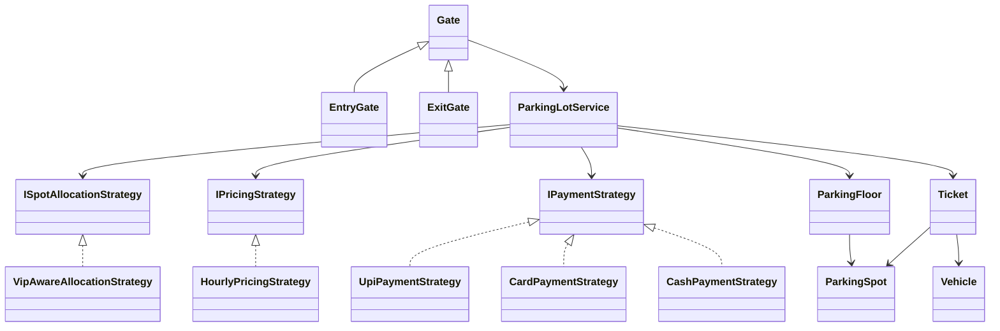

# Parking Lot Low-Level Design

This project is a small C++ parking-lot system based on the accompanying `LLD Diagram.png`. It models vehicle entry, spot allocation, ticket creation, payment, vehicle exit, and spot release.

## Design Overview



### Core Components

- `Vehicle` stores the license plate, vehicle type, and owner identifier.
- `ParkingSpot` stores its supported vehicle type, floor number, availability, and optional VIP reservation. Spot state changes are protected by `ParkingMutex`.
- `ParkingFloor` owns the spots on one floor.
- `Ticket` connects a vehicle to its allocated spot and records entry, exit, and payment state.
- `ParkingLotService` coordinates floors, active tickets, allocation, pricing, payment, and ticket numbering.
- `EntryGate` delegates vehicle admission to `ParkingLotService`.
- `ExitGate` delegates ticket settlement and spot release to `ParkingLotService`.

## Entry Flow

1. An `EntryGate` receives a `Vehicle` and entry hour.
2. `ParkingLotService` asks `VipAwareAllocationStrategy` for a compatible available spot.
3. A reserved spot is selected for its matching owner before public spots are considered.
4. The selected spot is occupied atomically.
5. The service creates an active ticket and stores it in the active-ticket map.
6. If no compatible spot exists, entry is denied and no ticket is created.

## Exit Flow

1. An `ExitGate` receives a ticket ID, exit hour, and payment strategy.
2. The service validates that the ticket is active and that exit time is not before entry time.
3. `HourlyPricingStrategy` calculates the fee. VIP-reserved tickets for their assigned owner are free.
4. The selected payment strategy processes any non-zero fee.
5. After successful payment, the ticket is marked paid, the spot is vacated, and the ticket is removed from active storage.
6. A failed payment leaves the ticket and spot active for retry.

## Strategy Pattern

Allocation, pricing, and payment are interfaces so the core service does not depend on one implementation:

- `ISpotAllocationStrategy`: choose an available spot.
- `IPricingStrategy`: calculate the parking fee.
- `IPaymentStrategy`: process payment through UPI, card, cash, or a future provider.

## Concurrency

`ParkingMutex` protects spot state, active tickets, and console output. Spot allocation uses `tryPark`, which checks and occupies a spot while holding the spot lock, preventing two gates from receiving the same spot. Exit processing serializes access to an active ticket so it cannot be paid or released twice.

The current sample runs entry requests sequentially because the installed GCC 6.3 toolchain does not provide `std::thread`. The service synchronization is still implemented for concurrent callers when built with a toolchain that supports standard threads.

## Build and Run

From the `ParkingLot` directory:

```powershell
g++ -std=c++17 -Wall -Wextra main.cpp -o parking_lot.exe
.\parking_lot.exe
```

Only `main.cpp` should be compiled directly. The project currently keeps its header-style declarations in `.cpp` files and includes them from `main.cpp`.

## Sample Scenario

The sample configures one VIP four-wheeler spot, one public four-wheeler spot, and one public two-wheeler spot. It then demonstrates:

- A regular vehicle receiving the public four-wheeler spot.
- A second regular four-wheeler being denied when no public spot remains.
- The reserved owner receiving the VIP spot.
- Regular hourly payment through UPI.
- Zero-fee VIP exit through cash payment.
- Both spots becoming available after exit.
